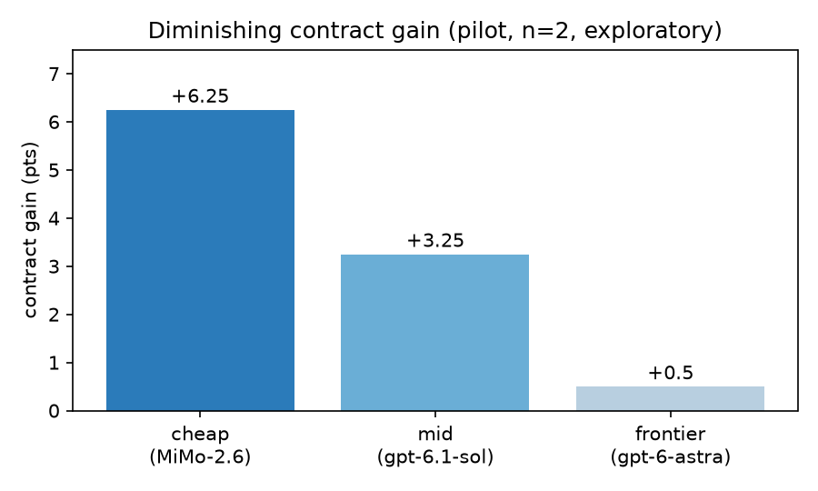

# Contract Core — lift cheap LLMs to flagship level on creative tasks

[](LICENSE)

**A 5-clause prompt "contract" that makes cheap models think before they write — measured across ~200 controlled outputs, with a self-optimization kit and an honest failure map.**

一句话:给便宜模型套一份 5 条款「合同」(先出方案/排除平凡误判/写明可被推翻/禁编造/结果诚实),在创意类任务上把它抬到接近旗舰模型裸奔的水平——附自优化工具包与诚实的失效边界。

> Status: **experimental**. Evidence from ~200 controlled outputs (4-arm/5-arm × blind dual-judge, pre-registered). Not a guarantee — read the failure map below before use.

## Evidence(实测,2026-11)

| Task domain | Cheap model + contract vs flagship bare | Mechanism gain (contract − bare, cheap model) | Verdict |
|---|---|---|---|
| Research / creative ideas | within ~2.5–12 pts (two independent task sets) | **+17.7 / +9.0** (both non-trivial) | direction consistent(claim scope & replication status: see failure map) |
| Engineering (code) | competitive (per-item spread −75.5…+92.5) | +6.0 (set A, below +10 threshold); code-task mechanical scores saturated at 100/100 | reliability insurance in restricted sandboxes (qualitative); mechanism gain **not established** |
| Writing | −9.3 / −7.5 (both sets) | −7.0 (set A) / +1.3 (set B) — **not reliable** | **failure boundary**: no reliable gain, and the lifted model still trails flagship bare on both sets |
| Data analysis | −4.7 (set A) / +7.3 (set B) | +1.7 / +3.3 (below +10 threshold) | no useful gain; (the earlier ≈0 figure referred to information-synthesis tasks, old S-set, ≈0 there) |

- 递减律(观察):模型越弱、合同吃得越多 — cheap +6.25 / mid +3.25 / frontier +0.5(pilot, n=2, exploratory only)。

  

```
┌─────────────────────────────────────────────┐
│  contracts/contract-core.md   ← the 5 clauses │
│        │                                      │
│        ▼                                      │
│  your agent runtime (hook / system prompt)    │
│        │                                      │
│        ▼                                      │
│  selftune/  ← measure, prune, inject pitfalls │
│    calibrate → A/B → prune → pitfalls → criteria│
└─────────────────────────────────────────────┘
```

## 30 秒上手

```bash
# 1) 把 contracts/contract-core.md 拼进你的任务提示前缀
# 2) 跑一次 A/B(每臂 ≥3 采样)
python3 selftune/ab_runner.py --tasks my_tasks/ \
  --engine 'claude -p < {prompt}' --samples 3 --out runs/
# 3) 打分后出 ΔQ 报告(对照噪声带)
python3 selftune/ab_runner.py --analyze runs/ --scores scores.json
```

端到端示例(5 分钟):`examples/`。

## 自优化工具包(selftune/,五件)

| Piece | File | What it does |
|---|---|---|
| Calibrator | `selftune/calibrate/` | 8 probes with difficulty gradient → capability profile + recommended clause config |
| A/B runner | `selftune/ab_runner.py` | paired bare/contract runs, ≥3 samples/arm, ΔQ with noise band |
| Pruning protocol | `selftune/修剪协议.md` | delete-clause rules with ≥2-locatable-evidence threshold (judged before results) |
| Pitfall injector | `selftune/pitfall_inject.py` | your lessons → standard pitfall entries → hook injection |
| Criteria generator | `selftune/判据生成器.md` | falsification-triple template (threshold / degradation plan / refuse-to-judge) |

**三条硬规则**(实测换来的):评测环境必须裸(`selftune/评测环境规范.md`)、必须多采样对照噪声带(**实测:同提示词双跑分差可达 ±50 分级,单样本结论无价值**)、修剪必须有可定位证据。

## 安全与范围

- MIT license;no telemetry;runs fully local against your own model endpoint.
- Contract text is model-agnostic;换模型不换合同,换模型后重测增益(工具包自带标定)。

## Failure map(边界速查,详见 [docs/applicability-map.md](docs/applicability-map.md))

**Where it helps(实测)**:

| 场景 | 结论 |
|---|---|
| ✅ 想法/方案/设计/评审(先想再写类) | 真实非平凡增益 **+17.7 / +9.0**(两独立任务集);对准的正是该域病灶(想当然/编造/不可证伪) |
| ✅ 受限沙箱交付可靠性 | 有"保险"价值(定性;外部 13 组代码任务行为证据) |
| ✅ 越弱的模型吃得越多 | 递减律(pilot n=2,观察口径;附评分天花板与差值代数耦合双警告,不作承诺) |

**Where it hurts / boundaries(如实,全部实测)**:

| 边界 | 内容 |
|---|---|
| ❌ 成品写作/交付文案 | 无可靠增益(−7.0/+1.3 两集),且抬起来仍追不上旗舰裸奔(−9.3/−7.5)——**别用**;脚手架挤占成品预算、读起来像模板 |
| ❌ 数据/计算类 | 无实用增益(+1.7/+3.3 未过 +10 阈;信息综合 ≈0) |
| ⚠️ 研究增益普适性 | 方向一致但**严格独立复现未过**(n=3/域,CI 极宽),主张按此收窄 |
| ⚠️ 自优化(删条款) | **未证明**(G≈+0.9 < 噪声地板)——修剪需要可运行测试器,文本证据不够 |
| ⚠️ 噪声 | 同提示词双跑分差可达 ±50 分级:**单样本结论无价值**,每臂 ≥3 采样对照噪声带 |
| ⚠️ 效度 | LLM-as-judge(跨族双评缓解未消除)、单一 cheap-model 主体、域覆盖 4 类、评测环境必须裸(三次整批返工的教训) |

**One-liner**:先想再写类任务(想法/方案/设计/评审)用它;成品文案与纯计算别用;先在自己的任务上测(selftune,30 分钟)。

---

## 中文摘要

给便宜模型套 5 条款「合同核心」,在创意类任务上实测增益 +17.7/+9.0(两独立任务集,双盲双评,预注册),方向一致地逼近旗舰裸奔;写作域无可靠增益(两集 −7.0/+1.3,抬起来仍追不上旗舰)、数据域无实用增益(+1.7/+3.3 未过阈)——失效边界如实公开。附自优化工具包(标定/A-B 测量/修剪协议/坑注入/判据生成)与评测环境规范。实测警示:单样本评分噪声可达 ±50 分级,任何增益结论必须多采样并对照噪声带。
